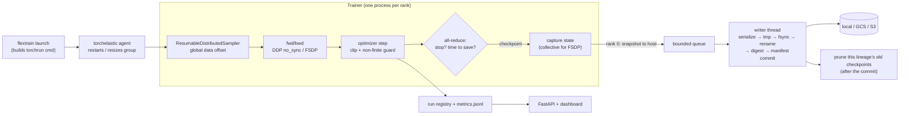

# FlexTrain

[](https://github.com/Varun-Dudipala/flextrain/actions/workflows/ci.yml)


A compact, fault-tolerant distributed training framework for PyTorch. It wraps DDP / FSDP
training with the machinery long-running jobs need to survive the real world: **non-blocking
checkpoints, exact resume after crashes, elastic resizing, and coordinated preemption**, each
covered by tests – including real multi-process `torchrun` jobs with injected failures.

```text
$ flextrain launch -c examples/gpt2_training/config.yaml --nproc-per-node 2 examples/gpt2_training/train_gpt2.py
step 20 | loss 4.1425 | lr 1.00e-03 | grad_norm 1.657 | 119 samples/s
Checkpoint step 20 queued (blocked 5.1 ms)          <- training resumes immediately
Checkpoint written: .../checkpoint_step00000020.pt  <- background thread, fsync'd, atomic
...
```

## What it guarantees (and how that is tested)

| Guarantee | Mechanism | Proven by |
|---|---|---|
| **Exact resume** – crash at step *k*, resume, and the final weights are *bitwise identical* to an uninterrupted run (shown on CPU; on a GPU this additionally needs deterministic algorithms, which FlexTrain does not switch on and no test covers) | checkpoints hold model, optimizer, LR schedule, grad scaler, every rank's RNG state and the sampler's global data position; data augmentation is seeded per sample, so it replays identically even from DataLoader worker processes | `tests/unit/test_trainer.py::TestExactResume`, `tests/integration/…::test_worker_crash_is_recovered_by_elastic_restart`, [randomized kills](#randomized-fault-injection) |
| **Non-blocking checkpoints** – the step loop pauses only for a device→host snapshot | snapshot into reusable (pinned) host buffers; serialize + write + `fsync` on a single FIFO background thread with bounded in-flight saves | `tests/unit/test_async_writer.py`, [benchmarks](#benchmarks) |
| **Failure recovery** – a crashed rank restarts the job from the newest *valid* checkpoint | torchelastic restarts the worker group → auto-resume (checkpoints that are unreadable or fail their SHA-256 digest are skipped); hangs become errors via the collective timeout | `test_worker_crash_is_recovered_by_elastic_restart`, `test_hung_worker_times_out_and_the_job_recovers`, `test_corrupted_latest_falls_back_to_previous`, `test_bit_rot_in_latest_falls_back_to_previous` |
| **Elastic resizing** – resume on a different number of ranks without repeating or skipping data, and with the same global batch when `global_batch_size` divides evenly. Weights then match an unresized run to 1e-5 (not bitwise: per-rank random streams are re-seeded on a resize; tested without dropout) | data position is tracked as a *global* sample offset and re-sharded for the new world size; gradient accumulation is re-derived from `global_batch_size` | `test_elastic_resize_resumes_from_exact_global_data_position`, `tests/unit/test_sampler.py` |
| **Coordinated preemption** – SIGTERM to *any one* rank stops *all* ranks after the same step with one consistent checkpoint | signal handler only sets a flag; ranks agree via an all-reduce at step boundaries; `flextrain launch` forwards a scheduler's SIGTERM or a terminal's Ctrl-C to the job | `test_sigterm_to_one_rank_stops_all_ranks_at_the_same_step`, `test_stop_signal_to_the_launcher_stops_the_whole_job_cleanly` |
| **Crash-safe storage** – a checkpoint is never observed half-written, and counts only once it is committed; retention deletes only checkpoints of the current lineage, and only after a newer one is committed | temp file → `fsync` → `os.replace` → `fsync(dir)`, then an atomically replaced `manifest.json` names it; pruning is part of that commit and is computed from the manifest (survives restarts) | `tests/unit/test_storage.py`, `tests/unit/test_checkpoint_manager.py` |
| **No silent restarts from scratch** – a job that cannot use its checkpoints fails instead of starting over | corrupted checkpoints are skipped, unreachable ones are retried and then raised, and "the lineage has checkpoints but none is usable" is an error; a failure on one rank is agreed on by all ranks through an all-reduce | `TestLoadFailures`, `TestResumeFailures`, `test_checkpoint_write_failure_on_rank_0_stops_every_rank_together` |
| **Divergence rollback** – NaN/Inf steps are skipped; if they persist, every rank goes back, without a restart, to the newest checkpoint that predates them and holds only finite values, skips the data up to the failure and carries on. The result is bitwise identical to a run that never saw the skipped data (shown in a single process on CPU with injected NaN losses; with two ranks the test checks that both end with the same weights) | decision uses the post-all-reduce gradient norm, identical on every rank; the same guard applies under fp16, where the loss scaler alone would skip bad steps silently and forever; the rollback is committed to storage before training continues, and `max_rollbacks` in a row end the run | `TestDivergenceGuard`, `TestDivergenceRollback`, `test_divergence_is_rolled_back_on_every_rank_without_a_restart` |

DDP training is verified to stay bitwise-identical across ranks and to match single-process
training with gradient accumulation (`test_two_ranks_match_single_process_with_accumulation`).

**What this evidence covers, and what it does not.** Every test and measurement in this README ran
on CPU with the `gloo` backend, with at most two ranks on one machine. Nothing here has been run
on a GPU, with NCCL, with FSDP, or across more than one node, and the largest model trained end to
end is GPT-2 small for a few dozen benchmark steps. The mechanisms are written for those
settings; the proof is not there yet. See [Limitations](#limitations-and-next-steps).

## Quick start

```bash
pip install -e ".[dev]"     # needs PyTorch >= 2.5; CPU-only machines work (CI runs on CPU with gloo)

# Single process: a tiny byte-level GPT-2 trained on this repo's own source code (no downloads)
python examples/gpt2_training/train_gpt2.py

# Two workers under the elastic agent. Kill one (kill -9 <pid>) and watch the group restart and resume.
flextrain launch -c examples/gpt2_training/config.yaml --nproc-per-node 2 examples/gpt2_training/train_gpt2.py

flextrain status --all      # runs from the registry: status, step, loss, restarts, last checkpoint
flextrain serve             # REST API + live dashboard at http://127.0.0.1:8000
```

Use it in your own code:

```python
from flextrain import Trainer, load_config

config = load_config("config.yaml")            # strict: typos and bad types are errors
with Trainer(model, config, train_dataset, eval_dataset=val_dataset) as trainer:
    result = trainer.train()                    # auto-resumes if checkpoints exist
print(result.status, result.global_step)        # "completed" or "preempted"
```

The model receives the batch (`model(**batch)` for dicts) and returns a scalar loss, a
`(logits, loss)` tuple, or anything with a `loss` field; override `Trainer.compute_loss` otherwise.

## How it works



**Async checkpointing.** Saving is split into the part that must be consistent with training and
the part that is merely slow. `capture_state` gathers model/optimizer state (wrapper-agnostic via
`torch.distributed.checkpoint.state_dict`, so a DDP checkpoint loads into FSDP or a single GPU), and
the snapshot copies it into host buffers that are allocated once and reused (pinned for CUDA, with
tied weights de-duplicated). Everything after that – pickling, writing, `fsync`, retention – runs on
one background thread. One writer keeps saves strictly ordered so "latest" always means "highest
step"; a bound on in-flight snapshots gives backpressure instead of unbounded host memory; and a
failed background write is re-raised on the training thread at the next save, because a checkpoint
that silently failed is the worst way to discover you have no checkpoint.

**Exact & elastic resume.** Each epoch has one deterministic global permutation. The sampler
splits the *unconsumed suffix* across the current ranks so that optimizer step *k* always consumes
the contiguous block `perm[k·G:(k+1)·G]` (G = global batch), whatever the world size. Progress is
therefore a single topology-independent integer, which is what makes resizing exact. With
`training.global_batch_size` set, 2 ranks × accumulation 1 becomes 1 rank × accumulation 2 after a
resize, so every step still consumes the same samples at the same global batch. The results then
agree to floating-point tolerance rather than bit for bit, because gradients are summed in a
different order and per-rank random streams (dropout) are re-seeded when the topology changes.

**Reproducible data.** Knowing *which* samples a step uses is not enough if the dataset augments
them randomly: DataLoader workers each have their own RNG stream, whose state depends on the
number of workers and on everything produced since the epoch began, so it cannot be restored
mid-epoch. FlexTrain instead seeds the Python, NumPy and torch RNGs from `(seed, epoch, sample
index)` before each sample, which makes per-sample augmentation independent of worker count, world
size and resume position. Collate functions are seeded from the first sample of their batch:
that is independent of worker count and resume position, but a batch's composition changes with
the world size, so collate-level randomness (e.g. dynamic masking) does not survive a resize
unchanged. Cost: about 10 µs per sample in a worker and 70 µs with
`num_workers=0`, where the training process's own RNG state is saved and restored around each
sample (measured on an Apple M-series laptop; `training.seed_per_sample: false` turns it off).

**Checkpoint integrity.** A `<checkpoint>.sha256` file (readable by `shasum -a 256 -c`) is written
after the checkpoint itself is durable and, when present, checked on every load (a checkpoint
whose writer died between those two writes is complete but loads unverified). Hashing runs on the writer
thread and added about 0.9 s per GB to the background write and 0.4 s per GB to a load on the same
laptop; `checkpoint.checksum: false` turns it off.

**Checkpoint identity.** A directory and a step number do not identify a checkpoint: reruns,
rollbacks and restarts all write `checkpoint_step<N>.pt` into the same place. Each directory
therefore has a `manifest.json` that records the *lineage* being written there (one continuous
training history) and which checkpoints belong to it. Auto-resume and retention look only at the
manifest, so leftovers of an earlier run can neither be resumed by accident nor crowd out new
checkpoints because their step numbers are higher. The rules:

- A fresh start, or a start from `checkpoint.resume_path`, begins a new lineage. `resume_path` is
  a starting point, not a standing order: once the branched lineage has checkpoints of its own, a
  restart continues from the newest of them rather than going back and discarding the work since.
- A restart within one `flextrain launch` always continues the lineage, whatever the config says.
- Continuing from step S drops the manifest entries after S (skipped as corrupted, or part of an
  abandoned future), so "highest step" and "most recent commit" cannot disagree.
- Continuing with different run-defining settings (learning rate, schedule, seed, `model` /
  `data` sections, ...) than the checkpoint was written with is refused unless
  `checkpoint.allow_config_change` is set; logging, cadence, workers and topology may change.
- The manifest carries a writer token. A process that finds another writer's token where it
  expected its own stops, so two jobs pointed at one directory cannot interleave for long.

**Divergence rollback.** Skipping a step whose gradient is NaN or infinite protects the weights
from that step. When the steps keep coming (`max_consecutive_nonfinite` in a row), the run has
diverged, and restarting it does not help: resume is exact, so the same data in the same order
produces the same divergence. FlexTrain instead does in-process what the PaLM authors did by hand
for loss spikes ([Chowdhery et al., 2022](https://arxiv.org/abs/2204.02311), section 5.1): go back
to an earlier checkpoint and skip the data that led to the failure.

- *Which checkpoint.* The newest one from before the first non-finite step whose model and
  optimizer state contain only finite values. The second condition matters: weights can turn to
  NaN one step before any gradient does, and a checkpoint written in between loads without error.
- *What is skipped.* The samples between that checkpoint's data position and the end of the step
  that failed. Optimizer steps are not skipped: the run continues at the checkpoint's step count
  and learning-rate schedule, on later data.
- *Durability.* Before training continues, the manifest drops the checkpoints of the abandoned
  stretch and a checkpoint with the new data position and the rollback count is written. A job
  that is killed right after a rollback therefore neither resumes from an abandoned checkpoint,
  nor replays the skipped data, nor gets a fresh rollback budget.
- *When it gives up.* After `fault_tolerance.max_rollbacks` (default 2) rollbacks in a row. The
  count resets once training gets past the step where it last diverged. `max_rollbacks: 0` turns
  rollback off. Every rollback is logged, written to `metrics.jsonl` and shown in the run registry
  and dashboard.

**Failure handling.**

| Failure | What happens |
|---|---|
| Worker process crashes (OOM, exception, `kill -9`) | The elastic agent tears the group down and restarts all workers (up to `elastic.max_restarts`); they resume from the newest usable checkpoint. A surviving rank that is blocked on the dead one cannot run a Python signal handler, so a watchdog thread exits it `fault_tolerance.stop_grace_seconds` after the agent's SIGTERM; without that it would sit out torchrun's fixed 30 s before being killed |
| Restarts exhausted, or rank 0 itself is killed | Rank 0 cannot record its own death, so `flextrain launch` marks the run `failed` in the registry once the agent gives up; a dead run never keeps reporting `running` |
| Worker hangs (deadlock, dead NIC) | `distributed.timeout_minutes` turns the stuck collective into an error → same as a crash (tested by freezing a rank with `SIGSTOP`) |
| Node joins/leaves (`--nnodes=MIN:MAX`) | Agent re-rendezvouses with the new size; data and batch geometry are re-derived on resume. Untested across machines: the resize tests restart a job with a different number of ranks on one machine |
| Preemption / SIGTERM / SLURM SIGUSR1 / Ctrl-C | Coordinated stop at the next step boundary, blocking checkpoint, `train()` returns `"preempted"`. A signal sent to `flextrain launch` is forwarded to the job once; the step and the save must finish within `elastic.shutdown_timeout` (default 60 s) or the agent kills the workers. A job that stopped this way exits 0. A second signal makes the launcher stop waiting (and marks the run `failed` unless the workers still record `preempted`); it does not kill the workers any faster |
| The launcher itself is killed (`kill -9`, a supervisor killing its process group) | The agent runs in its own session and watches its launcher; when the launcher is gone it stops the job the same coordinated way instead of running on unsupervised |
| Latest checkpoint corrupted (truncated, or bytes changed on storage) | Caught by the load failing or by the SHA-256 digest stored next to every checkpoint (`torch.load` alone accepts a flipped byte in the weights); skipped with a warning, and resume falls back to the previous one |
| Writer dies mid-save | Only a hidden temp file is left (cleaned up on next start); previous checkpoints untouched |
| Storage write fails | Retried with backoff (cloud blips), then raised on every rank together (only rank 0 writes; the others learn of it through an all-reduce); older checkpoints are never pruned |
| Storage unreachable when the job restarts | Reads are retried, then the job fails. An unreachable checkpoint is never treated as a missing one, so the job does not start over from step 0 |
| Every checkpoint of the lineage is corrupted | The job fails with the list of problems instead of silently training from scratch |
| Rerun with changed hyperparameters in the same directory | Refused with the list of changed settings (`checkpoint.allow_config_change` to override) |
| A second job writes to the same checkpoint directory | The job that finds a foreign writer token in the manifest stops with `CheckpointConflictError` |
| Loss/gradients become NaN/Inf | Step skipped. More than `max_consecutive_nonfinite` in a row triggers a rollback: all ranks reload the newest healthy checkpoint from before the first bad step, skip the data up to the failure and continue, with no restart. If there is no such checkpoint, or after `max_rollbacks` rollbacks in a row, the run raises and is marked `failed`; a restart by the elastic agent then fails the same way at once, because the rollback count is in the checkpoint. Rollback skips data and changes nothing else, so it does not rescue a run whose settings make it unstable (e.g. a learning rate that is too high) |

## Benchmarks

`scripts/benchmark.py` measures the example GPT-2 small (124M parameters) with a *realistic*
checkpoint – weights **and** AdamW state, 1.49 GB – reporting medians of repeated runs.
Reproduce with `make bench` (see `python scripts/benchmark.py --help`).

Measured on an Apple M3 laptop (8 cores, 16 GB, internal SSD, macOS, torch 2.15, CPU only; raw
data in [`results/benchmark_macos_arm64.json`](results/benchmark_macos_arm64.json)):

| GPT-2 small + AdamW checkpoint (1.49 GB) | Result |
|---|---|
| Training stall per checkpoint, synchronous save | 1.83 s |
| Training stall per checkpoint, **async save** | **0.11 s (−94%)** |
| First async save (allocates the reusable host buffers once) | 0.13 s |
| Background persist throughput (serialize + write + SHA-256 + flush to disk + manifest commit) | 601 MB/s |
| Checkpoint load throughput, warm page cache (includes verifying the digest) | 1.9 GB/s |
| Resume: load + restore model and optimizer | 0.80 s |

End to end – 30 training steps with a checkpoint every 10 – checkpointing costs **39%** extra wall
time with synchronous saves and **30%** with async saves (−24%). The end-to-end gain is much
smaller than the stall reduction *on this machine* because CPU training and the background writer
compete for the same cores and memory bandwidth. In GPU training the host is mostly idle while
the GPU computes, which is the case the design targets; that case has not been measured (run
`make bench` on a GPU machine). There is no cold-cache load number: evicting the page cache needs
`posix_fadvise`, which macOS does not have.

Methodology notes – mistakes an earlier version of this benchmark made, now fixed:

- *Load throughput read the file it had just written*, i.e. from the OS page cache. The page cache
  is now evicted first (`posix_fadvise(POSIX_FADV_DONTNEED)`); on virtualized disks the host may
  still cache blocks, so treat load numbers as an upper bound.
- *Checkpoints contained weights only.* Real checkpoints include optimizer state (~3× larger).
- *Single samples.* Now medians of repeats, with the one-time buffer allocation reported separately.

<details>
<summary>Earlier measurements (older code, not comparable)</summary>

v0.2 on a 4-vCPU cloud VM without a GPU (torch 2.14, virtual disk), before checksums and the
manifest existed: synchronous save 10.4 s, async 0.19 s (−98%), persist 231 MB/s, load 1.7 GB/s
with the page cache evicted, resume 3.0 s; end to end +80% (sync) vs +59% (async) over 35 steps.

v0.1 on a Tesla T4 (Colab):

Weights-only 500 MB checkpoint, single run, pre-dating the fixes above: async save blocked for
602 ms vs. ~3.9 s synchronous (127.7 MB/s), i.e. −85% stall; checkpoint load 1,169 MB/s (warm page
cache); resume 3.1 s; training 3,690 tokens/s at batch 8 × 512. Re-measure with the current
script for comparable numbers.

</details>

## Tests

```bash
make test               # everything (~6 min on an M-series laptop; quicker on Linux)
make test-unit          # fast unit tests
make test-integration   # real torchrun jobs (gloo backend) with injected failures
make chaos              # randomized fault injection campaign (see below)
pytest tests/gpu        # CUDA-only paths (AMP bf16/fp16, pinned snapshots); skipped without a GPU
```

366 test cases (parametrized cases counted individually; ~4.3k lines of tests for ~5.2k lines of
library code):

| Area | What is verified |
|---|---|
| Config (71) | type coercion incl. YAML `1e-4`, unknown-key errors with suggestions, every validation rule, overrides, round-trips |
| Checkpointing (83) | safe loading (no arbitrary unpickling), lineage manifest as the commit point, rewinding a lineage durably, finding the newest checkpoint with only finite values, retention scoped to the lineage, a second writer is fenced off, corrupted vs. unreachable checkpoints, SHA-256 digests catch flipped bytes that `torch.load` accepts, atomic writes leave no partial files, failed writes keep the previous checkpoint, async saves return before the write and are isolated snapshots, FIFO order, backpressure, drain on close, failures surface once, retention across restarts, corrupted-checkpoint fallback, GCS/S3 against fakes |
| Trainer (70) | divergence rollback (result bitwise identical to a run that never saw the skipped data, durable across a kill right after it, abandoned checkpoints never resumed from, NaN-weight checkpoints passed over, gives up after `max_rollbacks` in a row, works under the fp16 loss scaler and with DataLoader workers), `resume_path` applied once, changed hyperparameters refused, no silent restart from scratch, exact (bitwise) resume after a crash and after preemption, also with random augmentation in DataLoader workers, fp16 divergence guard, accumulation ≡ large batch, activation checkpointing ≡ none, divergence guard, LR schedules, checkpoint policy, eval, tracking |
| Sampler / elastic / fault tolerance (67) | stop watchdog frees a rank blocked in C++, launcher exit codes and stop signals, agent stops when its launcher dies, per-sample seeding independent of workers, world size and resume position, resume mid-epoch, re-sharding across world sizes without repeats or gaps, global-batch preservation, torchrun command construction, per-attempt rendezvous isolation, signal handling, launcher settles the status of dead runs |
| API / CLI / tracking (42) | endpoints, stale-run detection, CLI commands end to end, crash-tolerant JSONL, atomic registry |
| Multi-process integration (16) | real `torchrun` jobs: DDP sync, divergence rolled back on both ranks without a restart, killing the launcher stops the job, rank-0 write failure stops every rank together, crash → elastic restart → bitwise-identical result, frozen rank → timeout → restart, coordinated preemption, stop signals to the launcher, 2→1 rank resize, fixed-seed randomized kills |
| Example + GPU (17) | GPT-2 causality and shapes, example script end to end; CUDA AMP / pinned snapshots (GPU only) |

### Randomized fault injection

`tests/integration/chaos.py` attacks a running 2-rank job from the outside: each trial sends
`SIGKILL` to a randomly chosen rank once training passes a randomly chosen step, one to three
times per job, each kill aimed at the incarnation the previous one caused. The kills are sent
from outside and are not synchronized with the job. The harness does not record which phase a
kill interrupted; since a toy step is mostly a 20 ms pause, most of them land between steps
rather than inside a collective or a checkpoint write. A trial passes only if the job still exits 0, restarted exactly
once per kill, resumed from a checkpoint no older than the kill allows, trained every step on
exactly the samples an uninterrupted run uses, shows one `completed` run in the registry, and
ends with weights **bitwise identical** to an uninterrupted run on every rank.

| Campaign | Result |
|---|---|
| 40 trials, 75 kills delivered (43 on rank 0, 32 on rank 1; 8 before the first checkpoint existed) | **40 / 40 bitwise identical** |

Measured on an Apple M-series laptop (macOS, torch 2.15, CPU, gloo, 2 ranks on one machine, the
toy MLP used by the integration tests); raw per-trial data in
[`results/chaos_macos_arm64.json`](results/chaos_macos_arm64.json). It says nothing yet about
GPUs, NCCL, FSDP or more than one node. The harness was checked against deliberately broken
builds: with resume disabled, and with checkpoints that omit optimizer state, it fails. Three
fixed-seed trials run in CI on Linux (`tests/integration/test_chaos.py`); reproduce a campaign
with `make chaos`. CI runs the multi-process tests on Linux only: GitHub's macOS runner takes
35 s for each reverse lookup of a loopback address, which PyTorch does in every process, so the
macOS job runs the unit tests and the multi-process results on macOS are the local ones above.

It also found a bug: a job killed before its first checkpoint restarted under a new run name and
left the old registry record at `running` forever. All incarnations of a launch now share one
run name.

The integration tests found a real race: on an elastic restart, a worker could read its peer's
rendezvous address from the *previous* attempt and hang (4 of 6 runs), because torchrun keeps one
rendezvous store for all attempts. `flextrain launch` now asks for a fresh store per attempt
(`TORCH_DISABLE_SHARE_RDZV_TCP_STORE=1`). Jobs started with bare `torchrun` fall back to a
per-attempt key prefix, which is exact on one node but relies on a restart counter that each
node's agent keeps separately, so use `flextrain launch` for multi-node jobs.

## Configuration

One YAML file with typed, validated sections – `flextrain init-config` writes every option with
its default, and `flextrain validate cfg.yaml --world-size 8` shows the derived batch geometry.
Parsing is strict: unknown keys fail with a suggestion (`did you mean 'learning_rate'?`), and
values are coerced to their declared types (so YAML's `1e-4`, which PyYAML reads as a *string*,
works). Any value can be overridden with `--set section.key=value`.

| Section | Highlights |
|---|---|
| `main` | experiment / run name, output dir, seed, log level |
| `training` | per-device `batch_size`, `gradient_accumulation_steps` or `global_batch_size`, optimizer, warmup + cosine/linear schedule, `max_steps` / `max_epochs`, eval cadence, per-sample data seeding |
| `distributed` | `ddp` / `fsdp`, backend, collective timeout, FSDP sharding/prefetch/offload, `wrap_modules`, bf16/fp16, activation checkpointing |
| `checkpoint` | dir / `local`·`gcs`·`s3`, step- and time-based intervals, async + max in-flight saves, retention, SHA-256 digests, resume policy, `allow_config_change`, `allow_pickle` |
| `elastic` | nodes `min:max`, procs per node, rendezvous, `max_restarts`, `shutdown_timeout` (window for a preemption checkpoint) |
| `fault_tolerance` | handled signals, stop-check interval, `stop_grace_seconds` (watchdog for blocked ranks), non-finite guard, `max_rollbacks` (divergence rollback) |
| `model`, `data` | free-form, passed through to your script |

## Project layout

```text
flextrain/
├── config/           typed config sections, strict loader, overrides
├── core/             Trainer, process-group setup, resumable sampler, DDP/FSDP wrapping
├── checkpoint/       storage backends + digests, snapshot buffers, async writer, lineage manifest, manager
├── fault_tolerance/  coordinated preemption + stop watchdog, non-finite guard (rollback lives in the trainer)
├── elastic/          launcher (signals, exit status), agent wrapper around torchrun, resize-aware resume
├── tracking/         JSONL metrics, run registry
├── api/              FastAPI service + dashboard
└── cli/              flextrain launch | validate | init-config | status | inspect | serve
examples/gpt2_training/   GPT-2 (SDPA attention) + runnable training script
scripts/benchmark.py      checkpoint + end-to-end overhead benchmark
tests/{unit,integration,examples,gpu}/   integration/chaos.py is the randomized fault-injection harness
results/                  raw data behind the numbers quoted in this README
```

## Limitations and next steps

- **Full (gathered) state dicts.** FSDP checkpoints gather to rank 0, which is simple and portable
  but bounded by one host's memory. Sharded `torch.distributed.checkpoint` saves would be the next
  step for multi-billion-parameter models.
- **Unproven at scale.** All evidence is CPU / `gloo` / one machine / two ranks (see the note under
  the guarantees table). CI is CPU-only; the CUDA-specific tests in `tests/gpu` cover mixed precision
  and pinned snapshots on a single GPU and run only where one is available. **No test exercises
  FSDP**, and it is written against the older `FullyShardedDataParallel` API.
- **Multi-node needs shared or object storage.** Every rank loads the checkpoint that rank 0 chose,
  from the same path; node-local disks will not work, and each rank holds a full copy in host memory
  while it loads.
- **Divergence rollback is narrow.** It is triggered only by non-finite gradients (a loss that
  spikes but stays finite does not trigger it), and it changes only the data: a run that is
  unstable because of its settings diverges again and fails after `max_rollbacks`. It was tested by
  injecting NaN losses and NaN weights on CPU with one and two ranks, not with a model that
  diverges on its own, and not on a GPU or with FSDP.
- **Evaluation is approximate under DDP.** It uses the stock `DistributedSampler`, which pads with
  repeated samples, and averages per-batch means.
- **Data pipeline.** Map-style datasets only, and each epoch's permutation is materialized in memory
  on every rank, which is fine for millions of samples and not for billions.
- **Object stores are tested against in-memory fakes**, never against real S3 or GCS.
- **Restart-based elasticity.** Membership changes restart the worker group (torchelastic
  semantics) rather than resizing in place; the cost is one checkpoint load, which is what the
  async checkpointing and exact resume are optimized for.
- **Checkpoints are loaded without unpickling arbitrary objects** (`torch.load(weights_only=True)`),
  so a checkpoint cannot run code when it is loaded. Checkpoints written by FlexTrain ≤ 0.2, or
  holding custom scheduler / optimizer objects, need `checkpoint.allow_pickle: true`; only set it
  for files you trust. The SHA-256 digest protects against corruption, not tampering: it is stored
  next to the data.
- **PyTorch ≥ 2.5.** The full suite passes on 2.5.0 and 2.15.0. On 2.3 restoring state through
  `torch.distributed.checkpoint.state_dict` is not exact, and on 2.4 `torchrun` ignores
  `--local-addr` when every restart gets a fresh rendezvous store.

## License

MIT
